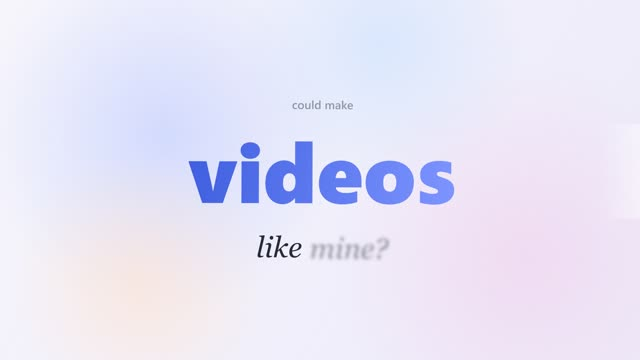
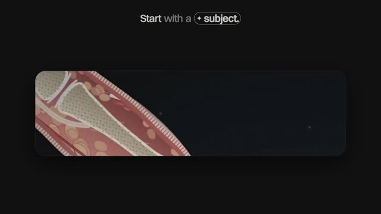
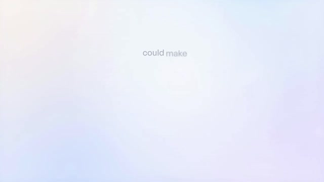
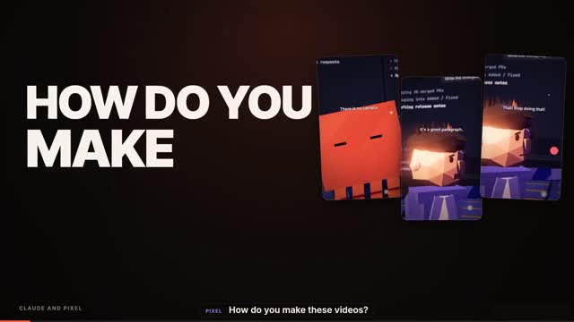

# Claude Motion Studio

A Claude plugin by **Abdullah** that turns Claude into a video studio. Give it a topic, a script or a reference video and it writes, animates, voices, captions, scores and renders the result, with every frame drawn in code.

Repo: <https://github.com/AbdullahFurkhan8/Claude-Motion-Studio>

## What's inside

| Skill | Folder | One-line summary |
|---|---|---|
| **Code Explainer Video** (3D / "how does X really work") | `skills/code-explainer-video` | 9:16 explainer shorts drawn 100% in code, synced word-by-word to a voiceover |
| **Poly-Animated Reels** | `skills/poly-animated-reels` | 9:16 low-poly 3D talking-character reels with Gemini voices, from a topic or script |
| **Motion Video Director** (motion graphics) | `skills/motion-graphics-skill` | Full director / designer / editor / sound-designer for motion graphics, product videos, captions and SFX |
| **20 Talking-Head Editing Styles** | `skills/20-talkinghead-editing-styles` | 20 ready-made animated styles for intros, hooks, overlays and raw-footage edits |

Shared resources at the plugin root:

- `sound-effects/` : whooshes, clicks, risers, camera shutters, gears, money, pops and more, used by the skills to score on-screen events.
- `tools/` : `gemini_tts.py` and locked Gemini voice presets.

---

## Watch the promos

Click a thumbnail to play the video. Every video below was made with this plugin.

| | |
|---|---|
| **Claude Motion Studio: the ad**<br>[](promos/claude-motion-studio-ad.mp4) | **Code Explainer Video**<br>[](promos/code-explainer-video-promo.mp4) |
| **Motion Video Director**<br>[](promos/motion-graphics-promo.mp4) | **Poly-Animated Reels**<br>[](promos/poly-animated-reels-promo.mp4) |

The 20 editing styles also have a preview reel: [`PREVIEW-all-20-styles.mp4`](skills/20-talkinghead-editing-styles/PREVIEW-all-20-styles.mp4).

---

## Install

### Claude Code (recommended: as a plugin)

```text
/plugin marketplace add AbdullahFurkhan8/Claude-Motion-Studio
/plugin install claude-motion-studio@claude-motion-studio
```

Then restart or reload, and run `/plugin` to confirm it is enabled. The skills appear as:

- `claude-motion-studio:code-explainer-video`
- `claude-motion-studio:poly-animated-reels`
- `claude-motion-studio:motion-video-director`
- `claude-motion-studio:20-talkinghead-editing-styles`

### Claude Code (as plain skills)

Clone the repo and copy the skill folders you want into `~/.claude/skills/` (every project) or `.claude/skills/` (one project):

```bash
git clone https://github.com/AbdullahFurkhan8/Claude-Motion-Studio.git
cp -r Claude-Motion-Studio/skills/* ~/.claude/skills/
```

### Claude app (claude.ai / desktop)

Zip a skill folder and upload it under **Settings → Skills**. Note: these skills render video with local tools (Node, ffmpeg, Playwright), so they need an environment with file and terminal access such as Claude Code.

### Requirements

| Needed for | What |
|---|---|
| All skills | Node 18+, Python 3.10+, `ffmpeg` on PATH |
| Rendering | `npm i playwright` (or `pip install playwright`) then `npx playwright install chromium` |
| Voice timing | `pip install faster-whisper numpy` (GPU optional, CPU works) |
| Poly-Animated Reels voices | `pip install google-genai` and a free Gemini API key from <https://aistudio.google.com>, set as the `GEMINI_API_KEY` environment variable |
| Optional new SFX | An ElevenLabs key in `ELEVENLABS_API_KEY` (Motion Video Director only) |

Never paste API keys into chat or commit them. Set them as environment variables.

---

## How to use it

Just describe the video. Claude picks the right skill from your request, or you can name one directly. Every skill first asks for the things it needs (assets, references, language) and then runs the whole flow, pausing only at the approval points.

### 1. Code Explainer Video

**What it makes:** a 9:16 "how does X really work" short, for example how a touchscreen, AirPods or a petrol pump work. Everything is drawn in code (Canvas, Playwright, FFmpeg): magnified cross-sections, glowing charge arcs, 3D grids, phone UI, hands, push-in cameras.

**Features**

- Word-by-word sync: every visual fires on the exact word time from your voiceover, so no hard-coded seconds. The same scenes fit any voice reading the script.
- Captions at the top: words blur in as they are spoken, the current word is bold, keywords get a blue selection box with corner handles and an optional emoji.
- "No still objects" motion rules: slow camera pushes, pseudo-3D turning, bobbing and breathing on every asset, flip-in cards, pulsing counters.
- Asset workflow: asks you for logos, product photos, screenshots or clips (SVG, PNG or video), cuts products out with `rembg`, masks personal names on screenshots, and draws anything missing itself.
- Sound design: SFX on real on-screen events only (cuts, taps, reveals), rotated variants, loudness-mastered to -14 LUFS. No caption-word sounds and no repeating pop or tick trains.
- Two-language builds: give a second voiceover (for example Hindi) and it builds both versions from the same scenes, with Hinglish captions.
- 1080x1920, H.264, 30 fps final render, versioned (v1, v2, never overwritten).
- 19 working example projects in `reference-code/` (touchscreen, airpods, iphone-keyboard, laptop-battery, mac-trackpad, petrol-pump, tesla roadster, openai-agents and more) to reuse as templates.

**Try:**

> "Use code-explainer-video. Here is my voiceover (voice.mp3) and script. Make a 'how does a fingerprint scanner work' short."

> "Make the same video in Hindi too with Hinglish captions."

### 2. Poly-Animated Reels

**What it makes:** low-poly 3D talking-character reels with two characters, banter, floating UI panels and captions, voiced with Gemini. You supply a topic or script; characters, voices, 15+ locations, lighting, UI panels, captions and sound are already built.

**Three ready brands**

| Brand | Style | Best for |
|---|---|---|
| `warm-explainer` | Hooded human and a hovering orange orb robot in a cosy location (cafe, train, office, library, apartment, diner), gold serif captions, floating browser and notification panels | Teaching one real, usable method |
| `dark-sitcom` | Big-headed hoodie kid and an orange block creature on a giant keyboard, gags on a giant screen (grids, code, error pages), bold sans captions | Comedy, loops, one request that escalates |
| `night-talk` | A small spiky-haired human and a glowing orange block or white robot at night (bench, fire escape, campfire, giant laptop), bokeh lights, soft white captions | Quiet, relatable, deadpan two-handers about working with AI |

**Features**

- Input can be a topic, a finished script, or a reference video / audio / transcript (it maps the reference's structure, then writes new original lines, never copying jokes or wording).
- Script formula per brand (`SCRIPT-FORMULA.md`) so hooks and payoffs land.
- Automatic fresh background and lighting for every video; locked character voices.
- Two approval gates: the script, then the voice preview. Say "do everything" to skip them.
- Word-aligned captions, mixed SFX, final 9:16 render, plus a caption and hashtags for posting.
- Beginner guide: `skills/poly-animated-reels/guide/poly-animated-reels-guide.html`.

**Try:**

> "poly-animated-reels, warm-explainer: teach me how to use ChatGPT to prepare for a job interview."

> "Make a dark-sitcom reel where the kid keeps asking the block creature for one more feature."

### 3. Motion Video Director (motion graphics)

**What it makes:** motion graphics, product videos, SaaS and brand ads, captioned edits and sound design, with Claude acting as director, motion designer, editor and sound designer.

**Features**

- Reference intake: analyzes a reference video or image first and tells you what can be built in code, what you must supply, and gives copy-paste AI prompts and file-format advice (SVG for logos and UI, transparent PNG for cutouts, WebP/JPEG for backgrounds, MP4 for clips).
- Pre-production pillars: brand, backgrounds and UI (as SVG so zooms stay sharp), a client brief, and a locked storyboard that Claude never reorders.
- Deterministic rendering: every frame depends only on time and explicit inputs; a canvas + Playwright render starter is included.
- 3D scenes with a cinematic toolkit guide (Three.js / React Three Fiber).
- Voiceover guidance (record your own or generate with a service of your choice) and word-timed `beats.json` that drives both visuals and SFX.
- Sound design: local audio analysis, procedural SFX recipes, optional ElevenLabs SFX generation (only with your approval and key), loudness and true-peak checks.
- Raw-footage editing: uses the 20 editing styles for cut timing, punch-ins, captions and visual rhythm.
- Project memory: reads `TASTE.md`, `PROGRESS.md` and `LOG.md` so it resumes where it left off.
- Safety rules: asks before installs, downloads and paid calls; never prints or packages secrets.
- Guides in `reference/` for design, fonts, recipes, asset hunting, setup and QA.

**Try:**

> "Use the motion director skill to make a 30-second product video for my app. Here is the logo and a reference video."

> "Edit this raw footage with captions, punch-ins and clean SFX. Vertical, 45 seconds."

### 4. 20 Talking-Head Editing Styles

**What it makes:** short animated cards, intros, hooks and **transparent overlays** you drop over a talking-head or raw footage. Each style is a working HTML animation plus a frame-exact renderer, so "make me a neon intro that says LIVE" becomes an MP4 in one go.

| # | Style | Skill | Makes |
|---|---|---|---|
| 01 | Particles | `motion-particles` | Particle swarm that forms a word, then explodes |
| 02 | Liquid Morph | `motion-liquid-morph` | Liquid-chrome metaballs, pastel iridescent sheen |
| 03 | Holographic | `motion-holographic` | Holographic foil ring |
| 04 | Neon Glow | `motion-neon-glow` | Neon sign that flickers on |
| 05 | Wireframe 3D | `motion-wireframe-3d` | Torus-knot wireframe drawing itself and spinning |
| 06 | Glassmorphism | `motion-glassmorphism` | Frosted-glass UI widgets over colour blobs |
| 07 | Kinetic Type | `motion-kinetic-type` | Punchy kinetic typography |
| 08 | Isometric | `motion-isometric` | Isometric block city |
| 09 | Clay 3D | `motion-clay-3d` | Squash-and-stretch clay toys |
| 10 | ASCII Art | `motion-ascii-art` | ASCII art |
| 11 | Gradient Mesh | `motion-gradient-mesh` | Flowing mesh gradient |
| 12 | Comic Book | `motion-comic-book` | Comic-book page |
| 13 | Split-Flap | `motion-split-flap` | Airport departures board |
| 14 | Retro VHS | `motion-retro-vhs` | 80s synthwave VHS scene |
| 15 | Halftone | `motion-halftone` | Halftone print art |
| 16 | Bauhaus | `motion-bauhaus` | Bauhaus geometric grid |
| 17 | Pixel Art | `motion-pixel-art` | 8-bit pixel-art scene |
| 18 | Blueprint | `motion-blueprint` | Technical blueprint |
| 19 | Art Deco | `motion-art-deco` | Art Deco gold reveal |
| 20 | Neo-Brutalism | `motion-neo-brutalism` | Neo-brutalist UI motion |

**Features**

- Same controls on every style: size (`--w --h`), duration (`--dur`), main and sub text (`--text --sub`), colours (`--set c1=ff0000`) and `--alpha` for a transparent `.mov` / `.webm` to lay over footage in Premiere, CapCut, DaVinci or Final Cut.
- Deterministic (seeded) so the same settings always give the same video; no external libraries or CDNs.
- `gallery.html` shows all 20 running live; each style has its own `SKILL.md`, `template.html`, `render.py` and `preview.jpg`.
- An index `SKILL.md` helps Claude recommend the right style for your hook, title card or lower third.

**Try:**

> "Use motion-neon-glow: sign says LIVE, sub line TONIGHT 9PM, 9:16, 5 seconds."

> "Kinetic type for my hook: STOP SCROLLING NOW, red and white, square."

> "Which of the 20 styles suits a finance talking-head? Render a still of two options."

Run one without Claude:

```bash
cd skills/20-talkinghead-editing-styles/motion-kinetic-type
python3 render.py template.html out.mp4 --text "MAKE IT MOVE" --w 1080 --h 1920
```

---

## Repository layout

```text
Claude-Motion-Studio/
├── .claude-plugin/
│   ├── plugin.json            plugin manifest
│   └── marketplace.json       lets people install via /plugin marketplace add
├── skills/
│   ├── code-explainer-video/
│   ├── poly-animated-reels/
│   ├── motion-graphics-skill/        (skill name: motion-video-director)
│   └── 20-talkinghead-editing-styles/
│       ├── SKILL.md                  index of the 20 styles
│       └── motion-*/                 one folder per style
├── sound-effects/             shared SFX library
├── tools/                     Gemini TTS helper and voice presets
└── README.md
```

## Tips

- Say which skill you want by name for the most predictable result.
- Give a voiceover or script up front; timing is built from the actual word times.
- Ask for a still or a low-resolution preview before the full render.
- Finished videos are versioned (`v1`, `v2`); earlier renders are never overwritten.

## Author

Built by **Abdullah** ([@AbdullahFurkhan8](https://github.com/AbdullahFurkhan8)).

## Licence

Copyright (c) 2026 Abdullah. You may use the plugin and everything you make with it, including commercial and client work. You may not resell, redistribute or publicly share the plugin, its sound effects or its templates. See [LICENSE.md](LICENSE.md) for the full terms.
